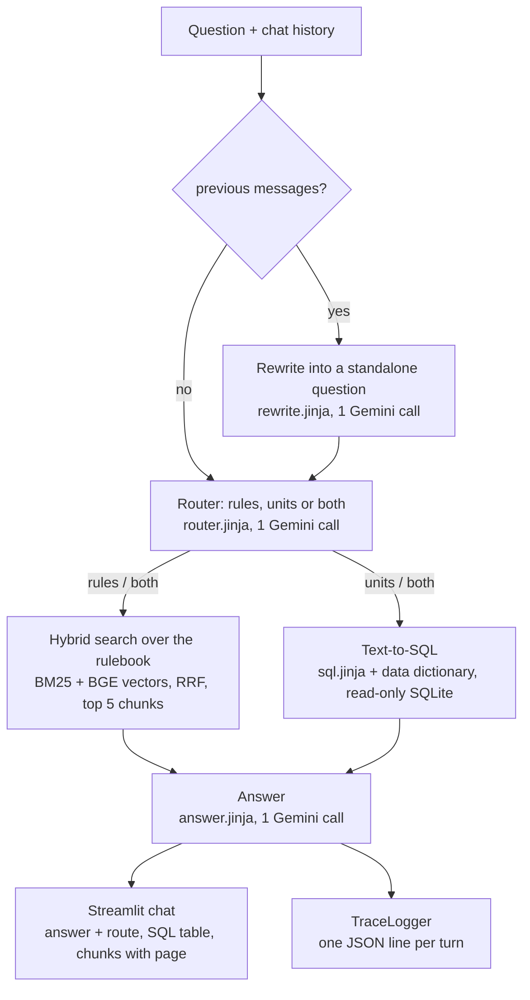
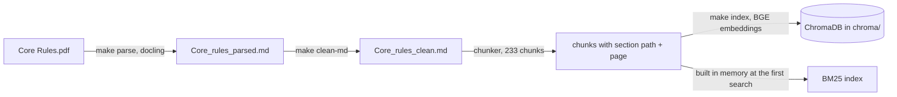

# Architecture

The assistant answers questions on the Warhammer 40k Core Rules (PDF) and on the unit
datasheets (SQLite database) with Gemini from Google AI Studio. The reasons behind each choice
are in [technical_choices.md](technical_choices.md).

## One chat turn

Everything in this diagram is `run_pipeline` in `src/rag/pipeline.py`, it returns a
`PipelineResult` (answer, route, standalone question, chunks, SQL result) that the chat and the
evaluation both read. All the Gemini calls go through the same client (`get_llm()`), which
throttles the requests, retries, falls back to another model when one is overloaded and has a
60 s timeout.

## Building the rulebook index (once)

The parsed and cleaned markdown are in git (parsing takes several minutes), `chroma/` is not, so
`make index` has to be run once after cloning.

## Code

| folder / file | what it does |
|---|---|
| `src/rag/settings.py` | every setting (models, paths, search parameters), can be changed in `.env` |
| `src/rag/base/` | the shared interfaces and dataclasses: `Chunk`, `BaseRetriever`, `LLMClient`, `SQLResult`, `PipelineResult`, `BasePipeline`, `Embedder`, `Reranker` |
| `src/rag/impl/llm/` | Gemini client |
| `src/rag/impl/parser/` | docling parsing and the cleaner |
| `src/rag/impl/chunker/` | splits the cleaned markdown by sections |
| `src/rag/impl/embedder/` | BGE embeddings (sentence-transformers) |
| `src/rag/impl/retriever/` | vector search (ChromaDB), BM25, hybrid fusion, optional reranker, `get_rulebook_retriever()` |
| `src/rag/impl/sql/` | text-to-SQL |
| `src/rag/impl/agent/` | router |
| `src/rag/prompts/` | the Jinja2 prompts (rewrite, router, sql, answer) |
| `src/rag/pipeline.py` | one chat turn (`run_pipeline`, `RagPipeline`) |
| `src/rag/monitoring/` | `TraceLogger`, logs every turn |
| `src/rag/evaluation/` | ragas test set generation, adapters for Gemini, evaluation runner, baseline pipeline |
| `scripts/` | the entry points used by the Makefile (parse, index, search, chat, testset, evaluate) |
| `tests/` | unit tests, no API key needed (`make test`) |

The `base` folder was written first: the pipeline, the chat and the evaluation only depend on
these types, so each of us could work on her part without waiting for the other, and the
evaluation can run on any `BasePipeline` (the baseline or the full pipeline).

## Data

| where | what | in git? |
|---|---|---|
| `data/Core Rules.pdf`, `data/wahadb.sqlite` | the two sources | no, too big, to add by hand |
| `data/SQL_AGENT_DATA_DICTIONARY.md` | description of the database, used in the SQL prompt | yes |
| `data/processed/` | parsed and cleaned rulebook | yes |
| `chroma/` | vector index | no, `make index` |
| `eval/` | test set, knowledge graph, results | yes |
